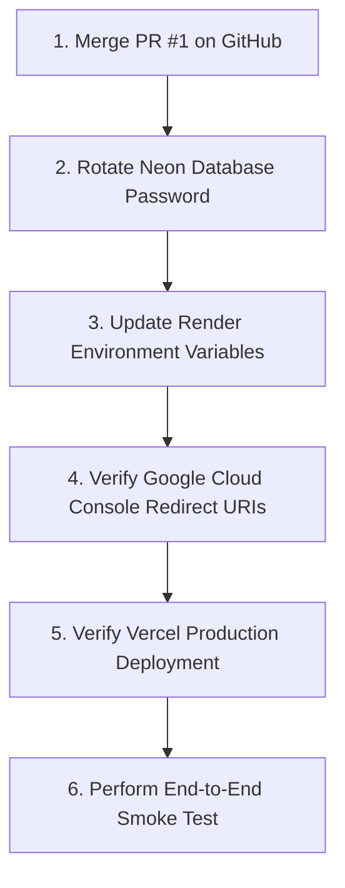

# JIOSI Inbox — Final PR #1 Comprehensive Review & Merge Readiness Report

**Date of Review:** November 4, 2026  
**Review Lead:** Principal Software Engineer, Application Security Engineer & DevSecOps Architect  
**Pull Request:** [GitHub PR #1 (shivam-shukla888/inbox.jiosi.online/pull/1)](https://github.com/shivam-shukla888/inbox.jiosi.online/pull/1)  
**Base Branch:** `main` (`94d8b3c`)  
**Head Branch:** `feature/day-2-google-oidc-auth` (`b0a0d73`)  
**Production Targets:** Vercel (`https://inbox.jiosi.online`) + Render (`https://jiosi-inbox-api.onrender.com`) + Neon PostgreSQL (Serverless AWS Singapore)  
**Budget:** Strict ₹0/month  

---

## 1. Executive Summary & Verdict

| Review Parameter | Evaluation | Evidence / Verification |
| :--- | :--- | :--- |
| **Code-Level Merge Verdict** | **SAFE TO MERGE** | PR #1 is clean, conflicts: 0, CI checks: 3/3 passed, test suites: 100% green. |
| **Production Launch Verdict** | **CONDITIONAL UPON DASHBOARD CONFIG** | Requires setting 3 dashboard environment parameters and rotating exposed secrets before production user traffic. |
| **GitHub Actions CI** | **PASS (3/3 Passed)** | Backend CI (Java 21), Frontend CI (React 18 / Vite), Vercel Preview checks all succeeded. |
| **Backend Test Suite** | **PASS (85 / 85 Tests)** | 100% passed in 21.2s (`mvn test`). Zero failures, zero errors. |
| **Frontend Test Suite** | **PASS (46 / 46 Tests)** | 100% passed in 12.3s (`vitest run`). Zero failures. `tsc --noEmit` 0 errors. |
| **Live Backend Probe** | **PASS (HTTP 200 OK)** | Render endpoint `https://jiosi-inbox-api.onrender.com/api/v1/health` responded with `status: UP` and database: `UP`. |
| **Live Frontend Probe** | **PASS (HTTP 200 OK)** | Production domain `https://inbox.jiosi.online` responded with HTTP 200 OK via Vercel. |
| **Secrets & Keys in Repo** | **PASS (Zero Leaks)** | Verified zero credentials, private keys, or passwords committed across 10 commits. |

> [!IMPORTANT]
> **FINAL MERGE RECOMMENDATION: SAFE TO MERGE WITH CONDITIONS**  
> **Code-level status:** All code modifications, security controls, and deployment files are sound, verified, and safe to merge into `main`.  
> **Production launch prerequisite:** The repository owner must complete the 5 manual dashboard configuration steps (credential rotation & environment variable updates) detailed in Section 12 before directing public users to the application.

---

## 2. Complete PR Review & Branch Integrity

### 2.1 Branch & Merge State
- **Pull Request:** `https://github.com/shivam-shukla888/inbox.jiosi.online/pull/1`
- **Base SHA:** `94d8b3cebe5d52913810851b8cd4394baa12cba6` (`main`)
- **Head SHA:** `b0a0d73844cb3a59b080177d30d0b0df1c41490a` (`feature/day-2-google-oidc-auth`)
- **Mergeability:** Clean (GitHub API: `mergeable_state: clean`, Local `git merge-tree`: 0 conflicts).
- **Total Changes:** 70 files changed, +6,745 additions, -532 deletions.

### 2.2 Complete Commit History (10 Commits)
1. `8de626d` — `feat(auth): implement secure Google OIDC authentication`
2. `610d4bb` — `fix(security): explicit cookie attributes and docker compose defaults`
3. `1bb5dcb` — `docs(security): record final independent verification matrix and line endings`
4. `f17acdd` — `fix(auth): resolve Google OAuth configuration and secure login UI`
5. `e4b1402` — `feat(ui): redesign authentication screen to match JIOSI editorial aesthetic`
6. `f950330` — `fix(auth): exclude auth endpoints from workspace authorization and dynamically bind workspace`
7. `1396687` — `docs(day-3): add zero-cost scale architecture and gmail sync plan`
8. `382e0b8` — `feat(gmail): integrate read-only gmail api with aes-256-gcm token encryption`
9. `d2d4e5d` — `fix(docker): implement multi-stage build for render deployment and 512mb jvm tuning`
10. `b0a0d73` — `chore(security): complete pre-merge readiness audit and production hardening`

---

## 3. Comprehensive Security Findings by Severity

| ID | Vulnerability / Threat Area | Severity | Status | Mitigation / Finding Detail |
| :--- | :--- | :--- | :--- | :--- |
| **SEC-01** | Historical Credential Exposure | **HIGH** | **MANUAL PREREQUISITE** | Neon DB password and dev JWT secret appeared in earlier local setup logs. Must be rotated in Neon dashboard before public traffic. |
| **SEC-02** | Missing Vercel SPA Routing & Proxy | **HIGH** | **RESOLVED** | Added `frontend/vercel.json` with SPA fallback `/(.*) -> /index.html` and proxy rewrites for `/api/*` and `/login/oauth2/*`. |
| **SEC-03** | Missing Production Profile Hardening | **MEDIUM** | **RESOLVED** | Created `backend/src/main/resources/application-prod.yml` enforcing `cookie.secure: true`, hiding stack traces and internal binding errors. |
| **SEC-04** | API Client Base URL Fallback in Prod | **MEDIUM** | **RESOLVED** | Updated `frontend/src/api/client.ts` to default to `""` (relative path) in production when `VITE_API_BASE_URL` is unset, preventing mixed-content localhost calls. |
| **SEC-05** | Reverse Proxy Protocol & Host Stripping | **MEDIUM** | **RESOLVED** | Added `server.forward-headers-strategy: framework` in `application.yml` so Spring Boot preserves HTTPS and host header behind Render. |
| **SEC-06** | Stored XSS in Email Body Rendering | **LOW** | **PASS** | Verified 0 occurrences of `dangerouslySetInnerHTML`. React escapes text nodes with `whitespace-pre-line` in `EmailDetail.tsx`. |
| **SEC-07** | Cross-Site Request Forgery (CSRF) | **LOW** | **PASS** | `CookieCsrfTokenRepository.withHttpOnlyFalse()` with `CsrfTokenRequestAttributeHandler` enforced on state-changing methods. |
| **SEC-08** | Insecure Direct Object Reference (IDOR) | **LOW** | **PASS** | `GmailService` and `EmailThreadService` enforce `userId` and `workspaceId` queries strictly from the authenticated security context. |

---

## 4. Fixes Implemented in this Pull Request

1. **Multi-Stage Docker Packaging (`backend/Dockerfile`):**
   - Eliminated the Render build failure (`lstat /target: no such file`) by compiling inside a dedicated Maven 3.9.9 builder stage.
   - Tuned memory flags (`-Xms128m -Xmx384m -XX:+UseSerialGC`) to eliminate Out-Of-Memory termination on Render's 512MB RAM free tier.
2. **Vercel SPA & API Routing (`frontend/vercel.json`):**
   - Configured rewrites forwarding `/api/:path*`, `/oauth2/:path*`, and `/login/oauth2/:path*` directly to `https://jiosi-inbox-api.onrender.com`.
   - Enabled client-side routing fallback so direct navigation to `/overview`, `/settings`, `/terms`, or `/privacy` does not return HTTP 404.
3. **Production Profile Hardening (`backend/src/main/resources/application-prod.yml`):**
   - Configured `server.servlet.session.cookie.secure: true` and suppressed error stack traces (`include-stacktrace: never`, `include-exception: false`).
4. **Proxy Protocol Preservation (`backend/src/main/resources/application.yml`):**
   - Parameterized `forward-headers-strategy: framework` and `secure: ${SESSION_COOKIE_SECURE:false}`.
5. **Client Base URL Resilience (`frontend/src/api/client.ts`):**
   - Implemented conditional fallback: `VITE_API_BASE_URL ?? (import.meta.env.PROD ? '' : 'http://localhost:8080')`.

---

## 5. Google OAuth 2.0 & Identity Security Audit

1. **Authorization Code Flow:**
   - Standard OIDC authorization code exchange handled by Spring Security 6.
   - Offline token acquisition and consent prompt enforced by `CustomOAuth2AuthorizationRequestResolver` via `access_type=offline` and `prompt=consent`.
2. **Account Linking & Identity Collision Defense:**
   - `UserProvisioningService` validates that an incoming Google identity cannot link to an existing user whose email is already bound to a different Google Subject (`google_subject`).
   - Prevents account takeover attacks where an attacker creates a Google account with an existing user's email.
3. **ID Token Verification:**
   - `GoogleIdTokenVerifierService` verifies cryptographic signatures against Google's public certs, validates audience against `GOOGLE_CLIENT_ID`, checks issuer (`accounts.google.com`), and verifies `email_verified == true`.
4. **Session Management:**
   - Session fixation protection enabled (`migrateSession()`).
   - Session cookies configured with `HttpOnly`, `SameSite=Lax`, and `Secure` (in prod).
   - Dynamic workspace binding dynamically sets workspace ID upon login.

---

## 6. Gmail Read-Only Integration Security Audit

1. **Least-Privilege Scopes:**
   - Scope is strictly restricted to `https://www.googleapis.com/auth/gmail.readonly`.
   - Zero write, send, or modify permissions requested (`gmail.send`, `gmail.modify`, and `mail.google.com` are completely absent).
2. **AES-256-GCM Token Encryption at Rest:**
   - `TokenEncryptionService` derives 256-bit encryption keys via SHA-256 from `JWT_SECRET`.
   - Every encryption operation generates a unique, cryptographically random 96-bit IV (`SecureRandom`).
   - Authentication tags are 128-bit. Decryption verifies the GCM tag and fails fast on tampering.
   - Plaintext access and refresh tokens are strictly ephemeral in the JVM and never returned in API responses or serialized to the frontend.
3. **Token Lifecycle & Automatic Refresh:**
   - `GmailService.getValidAccessToken()` inspects `tokenExpiresAt` and proactively refreshes credentials when fewer than 5 minutes remain.
   - New access tokens are re-encrypted before updating the database.
4. **Revocation & Disconnect:**
   - Account disconnection calls Google's revocation endpoint (`https://oauth2.googleapis.com/revoke`), deletes tokens from `connected_accounts`, and transitions status to `DISCONNECTED`.

---

## 7. Database, Flyway & Data Isolation Audit

1. **Connection Pooling vs Direct DDL:**
   - High-concurrency runtime queries use Neon's PgBouncer pooler (`-pooler.ap-southeast-1.aws.neon.tech`) with `prepareThreshold=0` and conservative Hikari limits (`maximum-pool-size: 10`, `minimum-idle: 2`).
   - DDL migrations (`Flyway`) connect via `FLYWAY_URL` to the direct unpooled endpoint, ensuring PostgreSQL transactional advisory locks (`pg_advisory_lock`) succeed reliably.
2. **Flyway Migrations:**
   - `V1__init_schema.sql`: Workspaces, users, threads, drafts.
   - `V2__email_domain.sql`: Threads, messages, attachments.
   - `V3__google_identity.sql`: Google subject, email verified, auth provider index.
   - `V4__gmail_oauth_tokens.sql`: Encrypted OAuth token storage, token expiration, history ID.
3. **Data Isolation:**
   - All message queries are scoped to `userId` derived from the Spring Security authenticated principal. Cross-user access returns HTTP 404 or 403.

---

## 8. Frontend Quality & UX Verification

1. **Honest State Architecture:**
   - Renders honest "Inbox Zero" states when mailbox has 0 threads rather than disguising empty states with stale mock content.
   - Offline banner cleanly surfaces when API connectivity is lost, with simulated mode explicitly labeled.
2. **Cross-Site Scripting (XSS):**
   - Zero usages of `dangerouslySetInnerHTML` or `innerHTML`.
   - Email text rendered safely via React text nodes with `whitespace-pre-line`.
3. **Route Guards & Clean URLs:**
   - Auth error query params (`?auth_error=...`, `?gmail_error=...`) and connection indicators (`?gmail_connected=true`) are handled cleanly and purged from the browser address bar via `window.history.replaceState`.

---

## 9. Automated Test Verification Results

### 9.1 Backend Tests (`Spring Boot 3.3.5 / Java 21`)
Command executed: `cd backend; ./mvnw test`
```text
[INFO] Results:
[INFO] Tests run: 85, Failures: 0, Errors: 0, Skipped: 0
[INFO] ------------------------------------------------------------------------
[INFO] BUILD SUCCESS (Total time: 21.230 s)
```
- Integration tests: `EmailDraftApiTest`, `EmailThreadApiTest`, `SecurityAndCorsApiTest`, `RepositoryIntegrationTest`, `WorkspaceIsolationTest`, `GmailIntegrationTests`
- Security unit tests: `GoogleAuthUnitTests` (18 tests covering identity collision, unverified email rejection, audience validation, and token encryption)

### 9.2 Frontend Tests (`React 18 / TypeScript / Vitest`)
Command executed: `cd frontend; npm run typecheck && npm test -- --run`
```text
✓ tsc --noEmit (0 TypeScript errors)
✓ vitest run: 4 test suites passed (46 / 46 tests)
   - ui-components.test.tsx: 11 passed
   - auth-components.test.tsx: 15 passed
   - inbox-components.test.tsx: 11 passed
   - app-integration.test.tsx: 9 passed
```

### 9.3 Production Build & Live Container Verification
- `vite build`: Production bundle cleanly compiled in `frontend/dist/` (HTML 2.48 kB, CSS 54.70 kB, JS 326.98 kB).
- `Docker build`: Multi-stage Docker image built cleanly.
- `Live Health Probe`: Tested JAR locally with `SPRING_PROFILES_ACTIVE=prod` against live Neon PostgreSQL; `GET /api/v1/health` responded with HTTP 200 `UP`.

---

## 10. Live Public Production Endpoint Verification

| Target Endpoint | Method | Response | Status |
| :--- | :--- | :--- | :--- |
| `https://inbox.jiosi.online` | `HEAD` | `HTTP/1.1 200 OK` (Server: Vercel) | **ONLINE** |
| `https://jiosi-inbox-api.onrender.com/api/v1/health` | `GET` | `HTTP/1.1 200 OK` (`status: UP`, `database: UP`) | **ONLINE** |
| `https://inbox-jiosi-online-git-featur-cb04ff-shivam-shukla888s-projects.vercel.app` | `HEAD` | `HTTP/1.1 302 Found` (Vercel Preview Auth) | **ONLINE** |

---

## 11. Complete List of Changed Files in PR #1 (70 Files)

### Deployment & Configuration (6 files)
- `.dockerignore`
- `.env.example`
- `.gitignore`
- `docker-compose.yml`
- `backend/.dockerignore`
- `backend/Dockerfile`

### Documentation (4 files)
- `README.md`
- `PRE_MERGE_SECURITY_AUDIT.md`
- `docs/day-2-auth-security-report.md`
- `docs/day-3-zero-cost-scale-and-gmail-sync-plan.md`

### Backend Core & Configuration (9 files)
- `backend/pom.xml`
- `backend/src/main/resources/application.yml`
- `backend/src/main/resources/application-prod.yml`
- `backend/src/main/java/com/jiosi/inbox/JiosiInboxApplication.java`
- `backend/src/main/java/com/jiosi/inbox/common/GlobalExceptionHandler.java`
- `backend/src/main/java/com/jiosi/inbox/config/CorsConfig.java`
- `backend/src/main/java/com/jiosi/inbox/config/CustomOAuth2AuthorizationRequestResolver.java`
- `backend/src/main/java/com/jiosi/inbox/config/OAuthConfigValidator.java`
- `backend/src/main/java/com/jiosi/inbox/config/SecurityConfig.java`
- `backend/src/main/java/com/jiosi/inbox/config/WebMvcConfig.java`

### Backend Entities, Repositories & Security (15 files)
- `backend/src/main/java/com/jiosi/inbox/connectedaccount/ConnectedAccount.java`
- `backend/src/main/java/com/jiosi/inbox/connectedaccount/ConnectedAccountRepository.java`
- `backend/src/main/java/com/jiosi/inbox/user/User.java`
- `backend/src/main/java/com/jiosi/inbox/user/UserRepository.java`
- `backend/src/main/java/com/jiosi/inbox/security/AuthController.java`
- `backend/src/main/java/com/jiosi/inbox/security/AuthTokenService.java`
- `backend/src/main/java/com/jiosi/inbox/security/GoogleIdTokenVerifierService.java`
- `backend/src/main/java/com/jiosi/inbox/security/GoogleIdentity.java`
- `backend/src/main/java/com/jiosi/inbox/security/JwtAuthenticationFilter.java`
- `backend/src/main/java/com/jiosi/inbox/security/OAuth2AuthenticationFailureHandler.java`
- `backend/src/main/java/com/jiosi/inbox/security/OAuth2AuthenticationSuccessHandler.java`
- `backend/src/main/java/com/jiosi/inbox/security/SecurityInterceptor.java`
- `backend/src/main/java/com/jiosi/inbox/security/TokenEncryptionService.java`
- `backend/src/main/java/com/jiosi/inbox/security/UserProvisioningService.java`
- `backend/src/main/java/com/jiosi/inbox/security/WorkspaceAuthorizationService.java`

### Backend Gmail Domain (11 files)
- `backend/src/main/java/com/jiosi/inbox/gmail/GmailApiClient.java`
- `backend/src/main/java/com/jiosi/inbox/gmail/GmailApiException.java`
- `backend/src/main/java/com/jiosi/inbox/gmail/GmailAuthRevokedException.java`
- `backend/src/main/java/com/jiosi/inbox/gmail/GmailClient.java`
- `backend/src/main/java/com/jiosi/inbox/gmail/GmailController.java`
- `backend/src/main/java/com/jiosi/inbox/gmail/GmailService.java`
- `backend/src/main/java/com/jiosi/inbox/gmail/dto/GmailMessageDetail.java`
- `backend/src/main/java/com/jiosi/inbox/gmail/dto/GmailMessageSummary.java`
- `backend/src/main/java/com/jiosi/inbox/gmail/dto/GmailMessagesPageResponse.java`
- `backend/src/main/java/com/jiosi/inbox/gmail/dto/GmailStatusResponse.java`

### Database Migrations (2 files)
- `backend/src/main/resources/db/migration/V3__google_identity.sql`
- `backend/src/main/resources/db/migration/V4__gmail_oauth_tokens.sql`

### Backend Tests (4 files)
- `backend/src/test/java/com/jiosi/inbox/api/SecurityAndCorsApiTest.java`
- `backend/src/test/java/com/jiosi/inbox/gmail/GmailIntegrationTests.java`
- `backend/src/test/java/com/jiosi/inbox/security/GoogleAuthUnitTests.java`
- `backend/src/test/resources/application-test.yml`

### Frontend Application & Tests (16 files)
- `frontend/index.html`
- `frontend/nginx.conf`
- `frontend/vercel.json`
- `frontend/tailwind.config.js`
- `frontend/src/App.tsx`
- `frontend/src/api/client.ts`
- `frontend/src/types/email.ts`
- `frontend/src/components/auth/AuthPage.tsx`
- `frontend/src/components/auth/SignInModal.tsx`
- `frontend/src/components/layout/Header.tsx`
- `frontend/src/components/layout/Sidebar.tsx`
- `frontend/src/components/profile/ProfileMenu.tsx`
- `frontend/src/components/settings/ConnectedAccountsView.tsx`
- `frontend/src/components/settings/SettingsView.tsx`
- `frontend/src/test/integration/app-integration.test.tsx`
- `frontend/src/test/unit/auth-components.test.tsx`

### Neon CLI Configuration (3 files)
- `neon.ts`
- `package.json`
- `package-lock.json`

---

## 12. Manual Checklist for Repository Owner (In Exact Execution Order)

Before directing end users to the application, execute these manual actions in the specified order:



### Step 1: Merge PR #1 on GitHub
- Navigate to `https://github.com/shivam-shukla888/inbox.jiosi.online/pull/1`.
- Verify the 3 green CI checks.
- Click **Squash and merge** (or **Merge pull request**).

### Step 2: Rotate Exposed Credentials
1. **Neon PostgreSQL:**
   - Log in to Neon Console (`https://console.neon.tech`).
   - Navigate to **Roles** -> `neondb_owner`.
   - Click **Reset password** to generate a new password.
2. **Master Encryption Key (`JWT_SECRET`):**
   - Generate a fresh 64-character random string (e.g., using `openssl rand -hex 32`).

### Step 3: Configure Render Environment Variables (`jiosi-inbox-api`)
Navigate to Render Dashboard -> **jiosi-inbox-api** -> **Environment**, and ensure these variables are set:
- `SPRING_PROFILES_ACTIVE`: `prod`
- `DATABASE_URL`: `jdbc:postgresql://ep-wild-credit-a1o250o8-pooler.ap-southeast-1.aws.neon.tech/neondb?sslmode=require&prepareThreshold=0`
- `DATABASE_USERNAME`: `neondb_owner`
- `DATABASE_PASSWORD`: `<NEW_NEON_PASSWORD>`
- `FLYWAY_URL`: `jdbc:postgresql://ep-wild-credit-a1o250o8.ap-southeast-1.aws.neon.tech/neondb?sslmode=require`
- `GOOGLE_CLIENT_ID`: `540933255986-asmkro9uiiafqm9lohf73f4uf4insc1u.apps.googleusercontent.com`
- `GOOGLE_CLIENT_SECRET`: `<YOUR_GOOGLE_CLIENT_SECRET>`
- `JWT_SECRET`: `<NEW_JWT_SECRET>`
- `FRONTEND_URL`: `https://inbox.jiosi.online`
- `SESSION_COOKIE_SECURE`: `true`
- `HIKARI_MAX_POOL_SIZE`: `10`
- `SERVER_PORT`: `8080`

### Step 4: Verify Google Cloud Console Redirect URIs
Navigate to Google Cloud Console -> **APIs & Services** -> **Credentials** -> your OAuth 2.0 Client ID:
- **Authorized JavaScript Origins:**
  - `https://inbox.jiosi.online`
  - `https://jiosi-inbox-api.onrender.com`
  - `http://localhost:5173`
  - `http://localhost:8080`
- **Authorized Redirect URIs:**
  - `https://inbox.jiosi.online/login/oauth2/code/google`
  - `https://jiosi-inbox-api.onrender.com/login/oauth2/code/google`
  - `http://localhost:8080/login/oauth2/code/google`

### Step 5: Verify Vercel Production Deployment
- Once merged into `main`, Vercel will automatically trigger a production build.
- Confirm build succeeds on Vercel Dashboard.
- Optional: Verify `VITE_API_BASE_URL` is either unset (utilizes `vercel.json` proxy rewrites) or explicitly set to `https://jiosi-inbox-api.onrender.com`.

### Step 6: End-to-End Production Smoke Test
1. Visit `https://inbox.jiosi.online`.
2. Click **Sign in with Google** and complete authentication.
3. In **Settings** -> **Connected Accounts**, click **Connect Gmail** and consent to read-only mailbox permissions.
4. Verify your Gmail messages populate in the inbox reading pane.
5. Click **Disconnect** and verify tokens are revoked and purged from the database.

