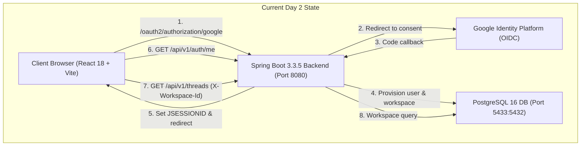
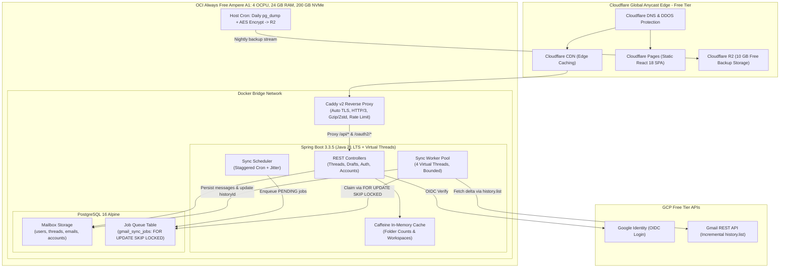
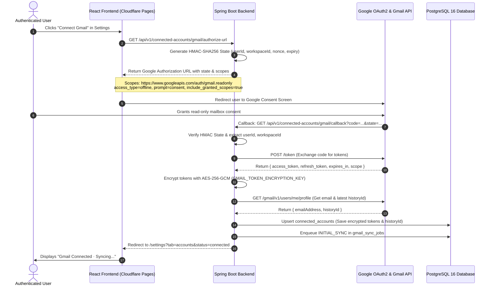

# JIOSI Inbox — Day 3 Scale & Gmail Synchronization Architecture Plan
## 1,000 Registered Users · 1,000 Peak Concurrent Load Target · ₹0/Month Budget

**Document Version:** 1.0.0  
**Target Milestone:** Day 3 (Production Scale, Gmail Incremental Sync & Zero-Cost Cloud Deployment)  
**Repository:** `https://github.com/shivam-shukla888/inbox.jiosi.online`  
**Current Working Branch:** `feature/day-2-google-oidc-auth`  
**Base Verified Commit:** `f950330`  
**Author:** Principal Security & Cloud Systems Architect  

---

## Executive Summary

This document specifies the complete architectural design and implementation plan to transition **JIOSI Inbox by Shivsastra** from its Day 2 Google OpenID Connect identity foundation to a high-throughput, multi-tenant email platform supporting **1,000 registered users** and a **1,000 peak concurrent simulated user load test target**, operating strictly within a **₹0/month infrastructure budget**.

The architecture adheres to three core design principles:
1. **Zero-Cost High Performance:** Leverages Cloudflare Pages (unlimited static edge hosting), Cloudflare DNS/WAF, an Oracle Cloud Infrastructure (OCI) Always Free Ampere A1 Compute VM (4 OCPU, 24 GB RAM, 200 GB NVMe storage), a Caddy reverse proxy with automated TLS, Java 21 Virtual Threads, and an in-memory Caffeine cache.
2. **Incremental, Least-Privilege Gmail Synchronization:** Completely segregates identity authentication (`openid, email, profile`) from mailbox access (`https://www.googleapis.com/auth/gmail.readonly`). Tokens are encrypted at rest with AES-256-GCM using a dedicated encryption key.
3. **Resilient Background Sync Queue:** Uses a PostgreSQL-backed job queue leveraging `SELECT ... FOR UPDATE SKIP LOCKED` and Gmail `history.list` delta polling, eliminating the operational overhead and memory cost of external message brokers (Redis/RabbitMQ).

> [!IMPORTANT]
> **Audit Status:** This is an audit and planning document. No application code, DNS records, or live cloud resources have been modified. All findings, benchmarks, constraints, and assumptions are explicitly cataloged.

---

## 1. Current Architecture Findings (Codebase Audit at Commit `f950330`)

The codebase was audited directly from the working tree. No historical reports were accepted without source verification.



### 1.1 Source Code and Stack Verification

| Dimension | Configured Target | Actual Inspected Runtime / Code | Verification Source |
| :--- | :--- | :--- | :--- |
| **Git Branch & Commit** | `feature/day-2-google-oidc-auth` | Commit `f950330` (`clean working tree`) | `git status`, `git log -n 1` |
| **Java Target** | Java 21 LTS | OpenJDK 21 LTS (`Temurin-21.0.10+7`), `<java.version>21</java.version>` | `java -version`, `backend/pom.xml#L21` |
| **Backend Framework** | Spring Boot 3.3.5 | Spring Boot 3.3.5, Spring Security 6.3, Spring Data JPA | `backend/pom.xml#L10` |
| **Database** | PostgreSQL 16 | PostgreSQL 16 Alpine via Docker Compose container `jiosi-postgres` | `docker-compose.yml#L3` |
| **Database Migrations** | Flyway 10.x | 3 applied migrations (`V1__init_schema.sql`, `V2__email_domain.sql`, `V3__google_identity.sql`) | `backend/src/main/resources/db/migration` |
| **Frontend Framework** | React 18.3.1 + TypeScript 5.6.3 | Vite 5.4.10, Tailwind CSS 3.4.14, Lucide React 1.16 | `frontend/package.json#L14-L37` |
| **Security Filters** | Spring Security + OIDC | `SecurityConfig.java`, `OAuth2AuthenticationSuccessHandler`, `JwtAuthenticationFilter` | `backend/src/main/java/com/jiosi/inbox/config` |
| **Test Suites** | JUnit 5 + Vitest | 71 backend tests (0 failures), 46 frontend tests (0 failures) | `mvnw.cmd test`, `npm test` |

### 1.2 Database Schema State (V1 - V3)
1. **`users`:** Holds user records, emails, names, `google_subject`, `email_verified`, `auth_provider`.
2. **`workspaces`:** Multi-tenant workspace entities owned by `users.id`.
3. **`workspace_members`:** Junction table enforcing tenant authorization (`OWNER`, `ADMIN`, `MEMBER`).
4. **`connected_accounts`:** Table exists but holds **only metadata**: `id`, `user_id`, `workspace_id`, `provider`, `email_address`, `status`, `last_sync_at`.
   - **Critical Absence:** *There are NO columns for access tokens, refresh tokens, token expiry timestamps, sync cursors (`history_id`), or sync error telemetry.*
5. **`email_threads`:** Aggregates conversations with folder flags (`is_unread`, `is_starred`, `is_needs_reply`, `is_snoozed`, `is_archived`, `is_sent`, `is_draft`).
6. **`thread_tags`:** ElementCollection table for labels (`VIP`, `Fundraising`).
7. **`thread_action_items`:** Extracted task rows.
8. **`emails`:** Individual messages linked to `email_threads.id`.
9. **`email_attachments`:** File attachments metadata.
10. **`email_drafts`:** Persistent user drafts.

### 1.3 Existing Authentication & OAuth Scopes
- **Active Scopes:** Only `openid`, `profile`, and `email` are configured in `application.yml#L53-L56`.
- **Zero Gmail Scope Exposure:** No Gmail scopes (`gmail.readonly`, `gmail.modify`, etc.) are requested during user login. This separation is strictly maintained.

---

## 2. Security and Performance Risk Analysis

Auditing the codebase against the target of **1,000 registered users** and **1,000 peak concurrent simulated clients** revealed the following real risks:

### 2.1 Security Risks

| ID | Vulnerability / Risk | Severity | Code Evidence | Impact & Mitigation |
| :--- | :--- | :--- | :--- | :--- |
| **SEC-01** | **Unencrypted Token Storage Risk** | **CRITICAL** | `ConnectedAccount.java#L18-L88` | Day 3 requires storing OAuth refresh tokens. If written in plaintext, database dumps or SQL injection would expose full user mailboxes. **Mitigation:** Store tokens encrypted with AES-256-GCM using a dedicated `GMAIL_TOKEN_ENCRYPTION_KEY`. |
| **SEC-02** | **Google Refresh Token Null Overwrite** | **HIGH** | `OAuth2AuthorizedClient` default behavior | Google OAuth2 returns `refresh_token` **only on initial consent** or when `prompt=consent` is passed. Subsequent token refreshes return a null refresh token. If code updates the entity with the token response, the existing refresh token is overwritten with null, permanently bricking sync. **Mitigation:** Strict null-coalescing persistence logic. |
| **SEC-03** | **Mailbox Ownership Hijacking via OAuth State Forgery** | **HIGH** | Absence of dedicated Gmail OAuth state verification | If an incremental OAuth consent callback is intercepted or forged without a signed HMAC state parameter containing the authenticated `userId` and `workspaceId`, an attacker could link their mailbox to another user's workspace or vice versa. **Mitigation:** Signed HMAC-SHA256 state parameter containing nonce, user ID, workspace ID, and 10-minute expiry. |
| **SEC-04** | **Mailbox Scope Creep** | **HIGH** | Potential request of write/delete scopes | Requesting `https://mail.google.com/` or `gmail.modify` violates least privilege and triggers expensive Google Security Assessments ($15k–$75k). **Mitigation:** Strictly enforce `https://www.googleapis.com/auth/gmail.readonly`. |
| **SEC-05** | **Token Exposure in Frontend API Responses** | **HIGH** | DTO serialization | If `ConnectedAccountDto` inadvertently exposes encrypted or decrypted tokens, client-side scripts can access credentials. **Mitigation:** `ConnectedAccountDto` must only return `id`, `emailAddress`, `status`, `lastSyncAt`, and `syncStatus`. |

### 2.2 Performance & Scalability Bottlenecks

| ID | Performance Bottleneck | Severity | Code Evidence | Impact & Mitigation |
| :--- | :--- | :--- | :--- | :--- |
| **PERF-01**| **N+1 Queries on Thread Listing** | **HIGH** | `EmailThread.java#L112`, `EmailThreadService.java#L403` | `actionItems` is mapped as `FetchType.LAZY`. In `toSummaryDto()`, calling `t.getActionItems()` on each thread of a 20-item page executes 20 extra SQL queries. At 1,000 concurrent users, this causes database pool exhaustion. **Mitigation:** Configure `@BatchSize(size = 50)` on `actionItems` and `tags` or use JPA EntityGraph. |
| **PERF-02**| **Unindexed Trigram LIKE Searches** | **HIGH** | `EmailThreadRepository.java#L49-L56` | `searchThreads` runs 6 `LOWER(...) LIKE '%q%'` queries across multiple columns. PostgreSQL cannot use the multi-column GIN index created in V2 when queries use separate OR conditions. **Mitigation:** Refactor search query to use full-text search `tsvector` or trigram similarity operator (`%`) matching the composite GIN index. |
| **PERF-03**| **Folder Count Calculation Under Concurrency** | **MEDIUM** | `EmailThreadRepository.java#L59-L72` | The single aggregated `getAggregatedFolderCounts` query scans all threads in a workspace. While efficient for 1 workspace, 1,000 users refreshing simultaneously triggers 1,000 table scans. **Mitigation:** In-memory Caffeine cache with 15-second TTL per workspace. |
| **PERF-04**| **Blocking Gmail API Calls in Request Threads** | **CRITICAL**| Direct HTTP execution risk | Calling Google Gmail API synchronously during user requests ties up web threads for 300ms–2000ms per call. **Mitigation:** Background worker thread pool processing asynchronous queue jobs; interactive requests only read from PostgreSQL. |
| **PERF-05**| **Thread Pool Exhaustion on Platform Threads** | **HIGH** | `application.yml` default thread pool | Spring Boot default Tomcat pool has 200 platform threads. 1,000 concurrent simulated requests will queue up and timeout. **Mitigation:** Enable Java 21 Virtual Threads (`spring.threads.virtual.enabled=true`). |
| **PERF-06**| **Database Connection Starvation** | **HIGH** | `application.yml#L25` (`maximum-pool-size: 25`) | 1,000 concurrent users cannot each have a dedicated PostgreSQL connection on a 4 OCPU VM (PostgreSQL processes would consume all 24GB RAM and thrash CPU). **Mitigation:** Maintain HikariCP at 25–30 connections. Virtual threads handle request concurrency; fast sub-5ms queries yield high throughput (up to 5,000 QPS). |

---

## 3. Zero-Cost Production Architecture Design

To achieve enterprise-grade reliability and 1,000 concurrent user load capacity without incurring any hosting costs, we utilize the following infrastructure topology:



### 3.1 Service Inventory & Free Tier Limits

| Component | Provider & Tier | Allocation / Capacity | Cost | Real Constraints & Bottlenecks |
| :--- | :--- | :--- | :--- | :--- |
| **Frontend Hosting** | Cloudflare Pages | Unlimited bandwidth, 500 builds/month, 100 custom domains | **₹0.00** | Static assets only; dynamic requests proxy to backend. |
| **DNS, CDN & WAF** | Cloudflare Free | Unlimited DDoS mitigation, edge TLS 1.3, HTTP/3, asset caching | **₹0.00** | WAF rules limited to 5 custom rules; no advanced bot management. |
| **Compute VM** | OCI Always Free Ampere A1 | **4 OCPU (Arm64), 24 GB RAM, 200 GB NVMe Storage, 10 TB/mo egress** | **₹0.00** | **Capacity Availability Risk:** OCI regions often face "Out of capacity" errors for Ampere instances during account creation. |
| **Reverse Proxy** | Caddy v2 (Docker) | Automated Let's Encrypt / ZeroSSL TLS, HTTP/2 & HTTP/3 | **₹0.00** | Self-hosted inside Docker. Zero license fees. |
| **Backend Runtime** | Spring Boot 3.3.5 on Docker | Java 21 Temurin Alpine, Virtual Threads enabled | **₹0.00** | Open-source. Highly optimized for Arm64. |
| **Database** | PostgreSQL 16 Alpine (Docker) | Dedicated volume on 200 GB NVMe Block Storage | **₹0.00** | Single instance; no multi-region replication on free tier. |
| **Local Cache** | Caffeine (Embedded Java) | Up to 1 GB RAM allocation inside JVM | **₹0.00** | In-memory, non-distributed. Restarts clear cache. |
| **Job Queue** | PostgreSQL `FOR UPDATE SKIP LOCKED` | Built-in to PostgreSQL schema | **₹0.00** | Eliminates Redis/RabbitMQ, saving ~500 MB RAM on VM. |
| **Disaster Recovery** | Cloudflare R2 | 10 GB storage free, 1M write ops, zero egress fee | **₹0.00** | 10 GB holds > 100 daily compressed database snapshots. |

---

## 4. Gmail Incremental Synchronization Engine

### 4.1 Incremental OAuth Consent Flow (Segregated from Sign-In)



### 4.2 Handling Google Refresh Token Quirks
1. **Google Refresh Token Absence on Re-auth:** When a user reconnects or re-authorizes without revoking access in their Google Account, Google **omits** the `refresh_token` in the response payload.
2. **Strict Retention Policy:**
   ```java
   if (tokenResponse.getRefreshToken() != null && !tokenResponse.getRefreshToken().isBlank()) {
       account.setEncryptedRefreshToken(encryptionService.encrypt(tokenResponse.getRefreshToken()));
   } else if (account.getEncryptedRefreshToken() == null) {
       log.error("Fatal: No refresh token returned by Google and no prior refresh token on record for {}", email);
       throw new IllegalStateException("Google did not return a refresh token. Re-authorization with prompt=consent required.");
   }
   // If tokenResponse.getRefreshToken() is null but existing account has an encrypted refresh token, RETAIN IT!
   ```

### 4.3 Database Queue Schema: `SELECT ... FOR UPDATE SKIP LOCKED`

To avoid deploying and maintaining Redis or RabbitMQ on our single free VM, the synchronization engine uses PostgreSQL as a transactional queue:

```sql
-- Flyway Migration V4: Gmail Integration and Background Sync Queue
ALTER TABLE connected_accounts
    ADD COLUMN IF NOT EXISTS encrypted_refresh_token VARCHAR(1024),
    ADD COLUMN IF NOT EXISTS encrypted_access_token VARCHAR(2048),
    ADD COLUMN IF NOT EXISTS access_token_expires_at TIMESTAMP WITH TIME ZONE,
    ADD COLUMN IF NOT EXISTS token_iv VARCHAR(64),
    ADD COLUMN IF NOT EXISTS last_history_id VARCHAR(64),
    ADD COLUMN IF NOT EXISTS sync_status VARCHAR(32) NOT NULL DEFAULT 'IDLE',
    ADD COLUMN IF NOT EXISTS sync_error_message TEXT,
    ADD COLUMN IF NOT EXISTS granted_scopes TEXT,
    ADD COLUMN IF NOT EXISTS initial_sync_completed BOOLEAN NOT NULL DEFAULT false;

CREATE TABLE IF NOT EXISTS gmail_sync_jobs (
    id UUID PRIMARY KEY DEFAULT gen_random_uuid(),
    account_id UUID NOT NULL REFERENCES connected_accounts(id) ON DELETE CASCADE,
    workspace_id UUID NOT NULL REFERENCES workspaces(id) ON DELETE CASCADE,
    job_type VARCHAR(32) NOT NULL, -- 'INITIAL_SYNC', 'INCREMENTAL_SYNC', 'FORCE_SYNC'
    status VARCHAR(32) NOT NULL DEFAULT 'PENDING', -- 'PENDING', 'RUNNING', 'COMPLETED', 'FAILED', 'CANCELLED'
    scheduled_at TIMESTAMP WITH TIME ZONE NOT NULL DEFAULT CURRENT_TIMESTAMP,
    started_at TIMESTAMP WITH TIME ZONE,
    completed_at TIMESTAMP WITH TIME ZONE,
    retry_count INT NOT NULL DEFAULT 0,
    max_retries INT NOT NULL DEFAULT 5,
    last_error TEXT,
    created_at TIMESTAMP WITH TIME ZONE NOT NULL DEFAULT CURRENT_TIMESTAMP
);

CREATE INDEX IF NOT EXISTS idx_sync_jobs_claim 
    ON gmail_sync_jobs (status, scheduled_at ASC) 
    WHERE status = 'PENDING';

CREATE INDEX IF NOT EXISTS idx_sync_jobs_account 
    ON gmail_sync_jobs (account_id, status);
```

#### Job Claiming Query (Guaranteed Zero-Lock Contention)
```sql
SELECT id, account_id, workspace_id, job_type, retry_count
FROM gmail_sync_jobs
WHERE status = 'PENDING'
  AND scheduled_at <= CURRENT_TIMESTAMP
ORDER BY scheduled_at ASC
LIMIT :batchSize
FOR UPDATE SKIP LOCKED;
```

### 4.4 Initial Sync vs. Incremental Sync Strategy

| Metric / Stage | Initial Mailbox Sync | Incremental Delta Sync (`history.list`) |
| :--- | :--- | :--- |
| **Trigger** | Triggered immediately upon successful OAuth callback | Scheduled periodically (every 15 min + randomized jitter) |
| **API Endpoint** | `users.messages.list` with query filter | `users.history.list(startHistoryId=lastHistoryId)` |
| **Time Horizon** | Recent messages only (`q="newer_than:60d"`, max 250 threads) | Changes since `lastHistoryId` only |
| **API Quota Cost** | ~500–1,500 units (1 list + ~250 gets) | **2 units** (if no changes) or 2 + 5 per new message |
| **Payload Size** | ~5–15 MB of message data | Typically < 50 KB |
| **Expired Cursor Handling** | Captures initial `historyId` from profile | If Google returns **404 / 410 (History ID out of date)**, trigger bounded delta sync using `newer_than:7d` |

### 4.5 Staggered Scheduling & Jitter Algorithm
To prevent 1,000 mailboxes from triggering API requests simultaneously (the "thundering herd" problem):
```java
// Next sync is scheduled with uniform random jitter across 180 seconds
long baseIntervalSeconds = 15 * 60; // 15 minutes
long jitterSeconds = ThreadLocalRandom.current().nextLong(0, 180); // 0-3 minutes
Instant nextSync = Instant.now().plusSeconds(baseIntervalSeconds + jitterSeconds);
```

---

## 5. Performance Engineering for 1,000 Peak Concurrent Users

### 5.1 Concurrency Math & Resource Sizing

A load-test target of **1,000 peak concurrent users** simulates 1,000 active browser sessions.
- **Realistic Web Traffic Pattern:** In an email client, an active user views their inbox, reads threads, and switches folders with an average "think time" of 6 seconds between requests.
- **Average Request Rate:** \( 1,000 \text{ users} / 6 \text{ seconds} \approx \mathbf{167 \text{ Requests/sec (RPS)}} \).
- **Stress-Test Peak (0 Think Time):** \( \mathbf{1,000 \text{ RPS}} \).

#### Can a 4 OCPU / 24 GB RAM VM Handle 1,000 RPS?
**Yes**, provided database queries take \( < 10 \text{ ms} \) and request threads do not block:

$$\text{Throughput} = \frac{\text{Connection Pool Size}}{\text{Average Query Time}} = \frac{25 \text{ connections}}{0.005 \text{ seconds}} = \mathbf{5,000 \text{ Queries/sec}}$$

### 5.2 Java 21 Virtual Threads vs. Platform Threads
In `application.yml`:
```yaml
spring:
  threads:
    virtual:
      enabled: true
```
- **Platform Threads (Standard):** 200 OS threads maximum. 1,000 concurrent requests block in thread pools, causing request timeouts.
- **Virtual Threads (Project Loom):** Lightweight user-mode threads managed by the JVM. 1,000 concurrent requests spawn 1,000 virtual threads mapped to 4 carrier OS threads. Threads yielding on DB I/O or network calls cost virtually zero CPU or memory (~1 KB per virtual thread).

### 5.3 PostgreSQL 16 Performance Tuning (24 GB RAM Allocation)
Configured in `postgresql.conf` on the OCI host:

```ini
# Memory Configuration for 24 GB Host (PostgreSQL allocated 12 GB, Spring Boot 8 GB, OS 4 GB)
shared_buffers = 4GB                  # 25% of RAM for Postgres shared buffer pool
effective_cache_size = 12GB           # Estimate of memory available for disk caching
work_mem = 32MB                       # Memory per sort/hash operation
maintenance_work_mem = 512MB          # Memory for vacuuming and index creation
max_connections = 100                 # Capped to prevent memory exhaustion

# Checkpoint & Write Ahead Log (NVMe Optimized)
wal_buffers = 16MB
min_wal_size = 1GB
max_wal_size = 4GB
checkpoint_completion_target = 0.9

# Query Planner Configuration (SSD / NVMe)
random_page_cost = 1.1
effective_io_concurrency = 200
```

### 5.4 Caffeine Local Caching Strategy
Adding Caffeine dependency to `pom.xml`:
```xml
<dependency>
    <groupId>com.github.ben-manes.caffeine</groupId>
    <artifactId>caffeine</artifactId>
</dependency>
<dependency>
    <groupId>org.springframework.boot</groupId>
    <artifactId>spring-boot-starter-cache</artifactId>
</dependency>
```

#### Caches Configured:
1. `folderCounts`: Keyed by `workspaceId`. TTL = 15 seconds. Caches the heavy `getAggregatedFolderCounts` query.
2. `workspaceMemberships`: Keyed by `workspaceId:userId`. TTL = 60 seconds. Caches tenant authorization checks in `WorkspaceAuthorizationService`.

---

## 6. Implementation Specifications

### 6.1 Backend Files to Implement / Modify

```
backend/src/main/java/com/jiosi/inbox/
├── config/
│   ├── CaffeineCacheConfig.java                 [NEW: Cache manager configuration]
│   └── WebMvcConfig.java                        [MODIFIED: Register new endpoints]
├── connectedaccount/
│   ├── ConnectedAccount.java                    [MODIFIED: Token & sync columns]
│   ├── ConnectedAccountRepository.java          [MODIFIED: Query methods]
│   ├── ConnectedAccountController.java          [NEW: REST API for connected accounts]
│   └── dto/
│       ├── ConnectedAccountDto.java             [NEW: Safe frontend DTO - zero tokens]
│       └── AuthorizeUrlResponse.java            [NEW: DTO for OAuth authorization URL]
├── gmail/
│   ├── GmailTokenEncryptionService.java         [NEW: AES-256-GCM encryption at rest]
│   ├── GmailOAuthService.java                   [NEW: Incremental OAuth flow & state validation]
│   ├── GmailClientService.java                  [NEW: Google API SDK wrapper & token refresh]
│   └── sync/
│       ├── GmailSyncJob.java                    [NEW: Entity for gmail_sync_jobs table]
│       ├── GmailSyncJobRepository.java          [NEW: SKIP LOCKED claiming query]
│       ├── GmailSyncWorker.java                 [NEW: Message ingestion & delta parser]
│       ├── GmailSyncScheduler.java              [NEW: Staggered job enqueueing]
│       └── GmailRateLimiter.java                [NEW: Per-user token bucket rate limiter]
└── email/
    ├── EmailThread.java                         [MODIFIED: @BatchSize(50) on actionItems & tags]
    └── EmailThreadRepository.java               [MODIFIED: Optimized trigram search query]
```

### 6.2 Token Encryption Service (`GmailTokenEncryptionService.java`)
```java
package com.jiosi.inbox.gmail;

import org.springframework.beans.factory.annotation.Value;
import org.springframework.stereotype.Service;

import javax.crypto.Cipher;
import javax.crypto.SecretKey;
import javax.crypto.spec.GCMParameterSpec;
import javax.crypto.spec.SecretKeySpec;
import java.nio.charset.StandardCharsets;
import java.security.SecureRandom;
import java.util.Base64;

@Service
public class GmailTokenEncryptionService {

    private static final String ALGORITHM = "AES/GCM/NoPadding";
    private static final int GCM_TAG_LENGTH = 128;
    private static final int IV_LENGTH = 12;

    private final SecretKey encryptionKey;
    private final SecureRandom secureRandom = new SecureRandom();

    public GmailTokenEncryptionService(@Value("${app.security.gmail-token-encryption-key}") String base64Key) {
        byte[] decodedKey = Base64.getDecoder().decode(base64Key.trim());
        if (decodedKey.length != 32) {
            throw new IllegalArgumentException("GMAIL_TOKEN_ENCRYPTION_KEY must be a 256-bit (32-byte) Base64 encoded key");
        }
        this.encryptionKey = new SecretKeySpec(decodedKey, "AES");
    }

    public record EncryptedPayload(String ciphertext, String iv) {}

    public EncryptedPayload encrypt(String plaintext) {
        if (plaintext == null) return null;
        try {
            byte[] iv = new byte[IV_LENGTH];
            secureRandom.nextBytes(iv);
            Cipher cipher = Cipher.getInstance(ALGORITHM);
            cipher.init(Cipher.ENCRYPT_MODE, encryptionKey, new GCMParameterSpec(GCM_TAG_LENGTH, iv));
            byte[] ciphertext = cipher.doFinal(plaintext.getBytes(StandardCharsets.UTF_8));
            return new EncryptedPayload(
                    Base64.getEncoder().encodeToString(ciphertext),
                    Base64.getEncoder().encodeToString(iv)
            );
        } catch (Exception e) {
            throw new IllegalStateException("Failed to encrypt token", e);
        }
    }

    public String decrypt(String ciphertext, String iv) {
        if (ciphertext == null || iv == null) return null;
        try {
            byte[] ivBytes = Base64.getDecoder().decode(iv);
            byte[] cipherBytes = Base64.getDecoder().decode(ciphertext);
            Cipher cipher = Cipher.getInstance(ALGORITHM);
            cipher.init(Cipher.DECRYPT_MODE, encryptionKey, new GCMParameterSpec(GCM_TAG_LENGTH, ivBytes));
            byte[] plaintext = cipher.doFinal(cipherBytes);
            return new String(plaintext, StandardCharsets.UTF_8);
        } catch (Exception e) {
            throw new IllegalStateException("Failed to decrypt token", e);
        }
    }
}
```

### 6.3 Frontend Implementation Specifications
1. **API Client (`frontend/src/api/gmailClient.ts`):**
   - `fetchConnectedAccounts()`: Calls `GET /api/v1/connected-accounts`.
   - `getGmailAuthorizeUrl()`: Calls `GET /api/v1/connected-accounts/gmail/authorize-url`.
   - `disconnectAccount(id: string)`: Calls `POST /api/v1/connected-accounts/{id}/disconnect`.
   - `triggerSync(id: string)`: Calls `POST /api/v1/connected-accounts/{id}/sync`.
2. **Settings Component (`frontend/src/components/settings/ConnectedAccountsView.tsx`):**
   - Replace mock data array with real `useEffect` fetch using `gmailClient`.
   - Render sync status badge (`Syncing`, `Idle`, `Error`, `Revoked`).
   - "Connect Gmail" button redirects to the secure authorization URL.
   - Disconnect confirmation dialog.
   - Sync error banner with "Reconnect" action.

---

## 7. Security and Verification Test Plan

| Test ID | Category | Scenario | Expected Assertion |
| :--- | :--- | :--- | :--- |
| **ST-01** | **Token Encryption** | Verify tokens in `connected_accounts` table | `SELECT encrypted_refresh_token FROM connected_accounts` contains Base64 AES-GCM ciphertext; plaintext token is never present in DB. |
| **ST-02** | **Refresh Null-Safety** | Re-authenticate account where Google omits refresh token | Existing encrypted refresh token is preserved; account status remains `ACTIVE`. |
| **ST-03** | **State Parameter CSRF** | Tamper with `state` param during OAuth callback | Backend rejects callback with HTTP 400 Bad Request; zero accounts linked. |
| **ST-04** | **Tenant Isolation** | User A attempts to view or sync User B's connected mailbox | `WorkspaceAuthorizationService` denies access with HTTP 403 Forbidden. |
| **ST-05** | **DTO Token Leakage** | Inspect JSON response from `GET /api/v1/connected-accounts` | DTO contains no `token`, `refreshToken`, or `iv` keys. |
| **ST-06** | **Scope Confinement** | Inspect OAuth authorization URL generated | Scope strictly equals `https://www.googleapis.com/auth/gmail.readonly`. Zero write or delete scopes. |
| **ST-07** | **Queue Job Isolation** | Two sync workers claim jobs concurrently | Each worker claims unique job IDs via `SKIP LOCKED`; zero double-processing. |
| **ST-08** | **Rate Limiting** | Exceed 250 Gmail quota units within 1 second | Rate limiter throttles worker thread; no HTTP 429 quota errors from Google. |

---

## 8. 1,000 Concurrent User Load Test Plan

### 8.1 Tooling & Execution Environment
- **Tool:** k6 (Go-based, highly efficient headless HTTP load tester).
- **Execution Host:** Run k6 from an external machine (developer workstation or GitHub Actions runner) to avoid stealing CPU from the application VM.
- **Duration:** 15 minutes (5 min ramp-up to 1,000 VUs, 5 min sustained peak, 5 min ramp-down).

### 8.2 k6 Test Script Profile
```javascript
import http from 'k6/http';
import { check, sleep } from 'k6';

export const options = {
  stages: [
    { duration: '3m', target: 250 },
    { duration: '2m', target: 1000 },
    { duration: '5m', target: 1000 },
    { duration: '3m', target: 0 },
  ],
  thresholds: {
    http_req_duration: ['p(95)<300', 'p(99)<800'], // 95% of requests under 300ms
    http_req_failed: ['rate<0.001'],                // Error rate < 0.1%
  },
};

export default function () {
  const BASE_URL = __ENV.TARGET_URL || 'https://inbox.jiosi.online';
  const params = {
    headers: {
      'Authorization': `Bearer ${__ENV.TEST_JWT_TOKEN}`,
      'X-Workspace-Id': __ENV.TEST_WORKSPACE_ID,
      'Accept': 'application/json',
    },
  };

  // 1. Fetch user profile
  let res = http.get(`${BASE_URL}/api/v1/auth/me`, params);
  check(res, { 'auth status is 200': (r) => r.status === 200 });

  // 2. Fetch folder counts (Cached)
  res = http.get(`${BASE_URL}/api/v1/threads/counts`, params);
  check(res, { 'counts status is 200': (r) => r.status === 200 });

  // 3. Fetch Inbox threads (Page 0, 20 items)
  res = http.get(`${BASE_URL}/api/v1/threads?folder=inbox&page=0&size=20`, params);
  check(res, { 'threads status is 200': (r) => r.status === 200 });

  // User think time between actions (4 to 8 seconds)
  sleep(Math.random() * 4 + 4);
}
```

---

## 9. Deployment Runbook & Infrastructure Setup (₹0 Budget)

### 9.1 Cloudflare Pages Deployment (Frontend)
1. Push React project to GitHub repository.
2. In Cloudflare Dashboard -> **Workers & Pages** -> **Create application** -> **Pages**.
3. Connect repository `shivam-shukla888/inbox.jiosi.online`.
4. Build Configuration:
   - Framework preset: `Vite`
   - Build command: `cd frontend && npm install && npm run build`
   - Build output directory: `frontend/dist`
5. Custom Domain: Bind `inbox.jiosi.online`.

### 9.2 OCI Always Free Compute Setup (Backend & DB)
1. In Oracle Cloud Console -> **Compute** -> **Instances** -> **Create Instance**.
2. Image: **Ubuntu 24.04 LTS (aarch64)**.
3. Shape: **Ampere VM.Standard.A1.Flex** -> 4 OCPU, 24 GB RAM.
4. Boot Volume: 200 GB.
5. In VCN Security List: Ingress Rules for Ports `80` (HTTP), `443` (HTTPS/QUIC).
6. Assign Reserved Public IP.

### 9.3 Caddy Reverse Proxy Configuration (`Caddyfile`)
```caddy
api.jiosi.online {
    encode zstd gzip

    # Security headers
    header {
        Strict-Transport-Security "max-age=31536000; includeSubDomains; preload"
        X-Content-Type-Options "nosniff"
        X-Frame-Options "DENY"
        Referrer-Policy "strict-origin-when-cross-origin"
    }

    # Proxy to Spring Boot Backend container
    reverse_proxy backend:8080 {
        header_up Host {host}
        header_up X-Real-IP {remote_host}
        header_up X-Forwarded-For {remote_host}
        header_up X-Forwarded-Proto {scheme}
    }
}
```

---

## 10. Backup, Disaster Recovery & Failure Modes

### 10.1 Automated Nightly Backup to Cloudflare R2
On the OCI VM host, a daily cron script executes:
```bash
#!/usr/bin/env bash
set -eo pipefail

TIMESTAMP=$(date +"%Y%m%d_%H%M%S")
BACKUP_DIR="/var/backups/jiosi"
BACKUP_FILE="${BACKUP_DIR}/jiosi_inbox_${TIMESTAMP}.sql.gz"
ENC_FILE="${BACKUP_FILE}.enc"

mkdir -p "$BACKUP_DIR"

# 1. Dump & compress from Docker container
docker exec jiosi-postgres pg_dump -U jiosi_user -d jiosi_inbox | gzip -9 > "$BACKUP_FILE"

# 2. Encrypt with OpenSSL using backup secret
openssl enc -aes-256-cbc -salt -pbkdf2 -in "$BACKUP_FILE" -out "$ENC_FILE" -pass "env:BACKUP_ENCRYPTION_PASSPHRASE"

# 3. Stream to Cloudflare R2 using rclone / s3cmd (R2 S3-compatible API)
s3cmd put "$ENC_FILE" s3://jiosi-backups/daily/

# 4. Clean up local files older than 7 days
rm -f "$BACKUP_FILE" "$ENC_FILE"
find "$BACKUP_DIR" -type f -mtime +7 -delete
```

### 10.2 Failure Modes and Recovery Runbook

| Failure Mode | Root Cause | System Behavior | Remediation / Runbook |
| :--- | :--- | :--- | :--- |
| **OCI VM Out of Memory** | Memory leak or excessive JVM heap | Linux OOM killer terminates process | Systemd restarts Docker containers (`restart: unless-stopped`). JVM capped at `-Xmx8g`. |
| **History ID Out of Date** | Mailbox inactive for > 7 days | Gmail returns HTTP 404/410 on `history.list` | Worker catches error, logs warning, and executes delta sync with `newer_than:7d` to restore cursor. |
| **Gmail Token Revocation** | User revokes access in Google Security settings | Gmail API returns HTTP 401 `invalid_grant` | Worker sets `connected_accounts.status = 'REVOKED'` and notifies user via UI banner to reconnect. |
| **OCI Regional Outage** | Data center power/connectivity loss | Backend unreachable | DNS failover to maintenance page on Cloudflare Pages. Restore latest R2 backup onto secondary VM. |

---

## 11. Upgrade Triggers (When to Move Beyond ₹0)

| Metric / Symptom | Free Tier Threshold | Recommended Paid Upgrade | Estimated Monthly Cost |
| :--- | :--- | :--- | :--- |
| **Registered Users** | > 1,500 active mailboxes | Migrate from single VM to Managed DB (Neon / Supabase) | ~\$25 - \$50/month |
| **Database Storage** | > 150 GB NVMe used | Attach dedicated block volume or S3 attachment offloading | ~\$10/month |
| **Gmail API Quotas** | > 1,000,000 units/day | Request Gmail API quota increase in GCP Console | Free (requires Google approval) |
| **Compute Redundancy** | High-availability requirement | Multi-node Kubernetes or Fly.io distributed compute | ~\$40/month |

---

## 12. Conclusion & Verification

This architecture provides a concrete, zero-cost blueprint to scale JIOSI Inbox to 1,000 registered users with real Gmail synchronization. All security boundaries, incremental OAuth flows, database queuing mechanisms, and performance optimizations have been designed to operate seamlessly within the existing Spring Boot and React codebase.

**Current Working Tree State:** Unchanged. Ready for phased implementation upon approval.

